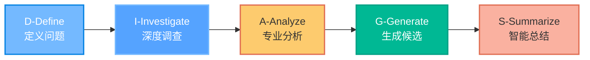
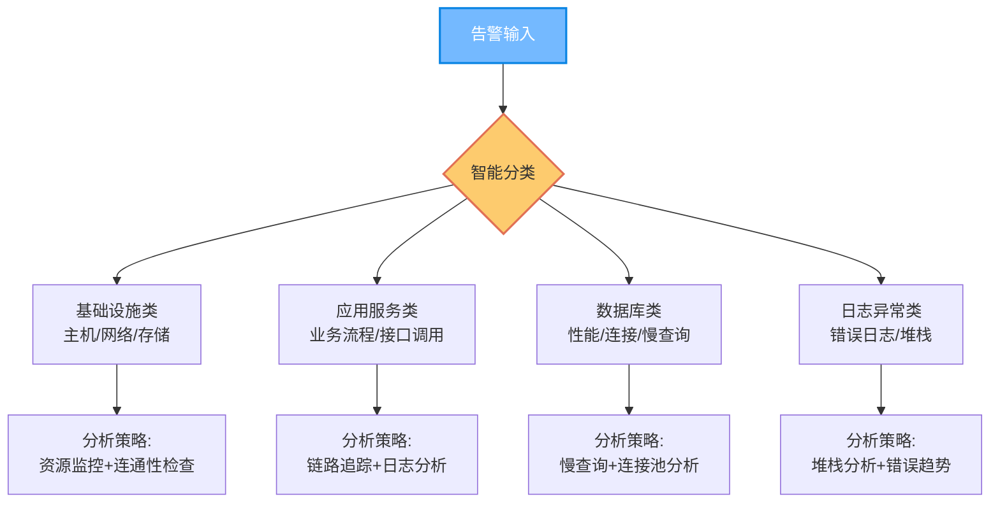
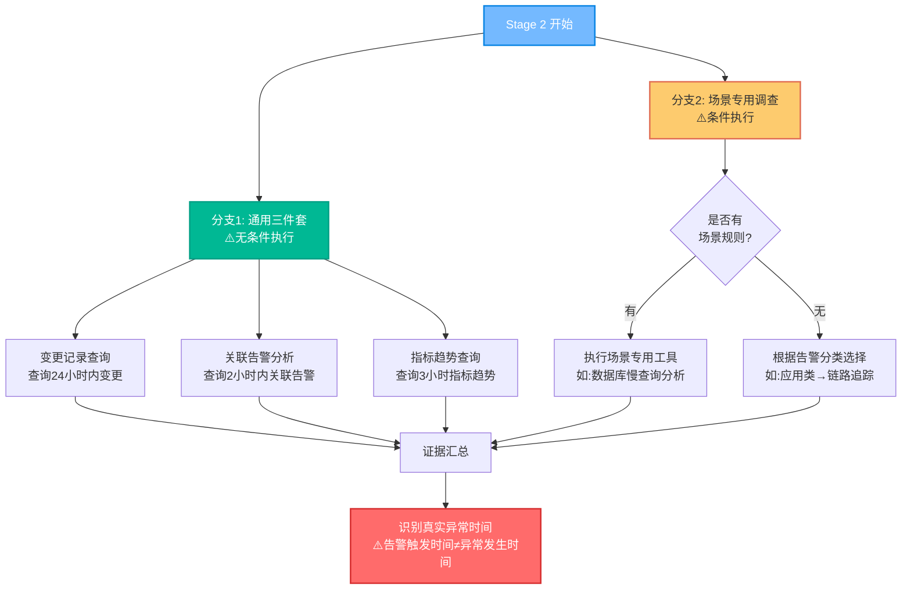
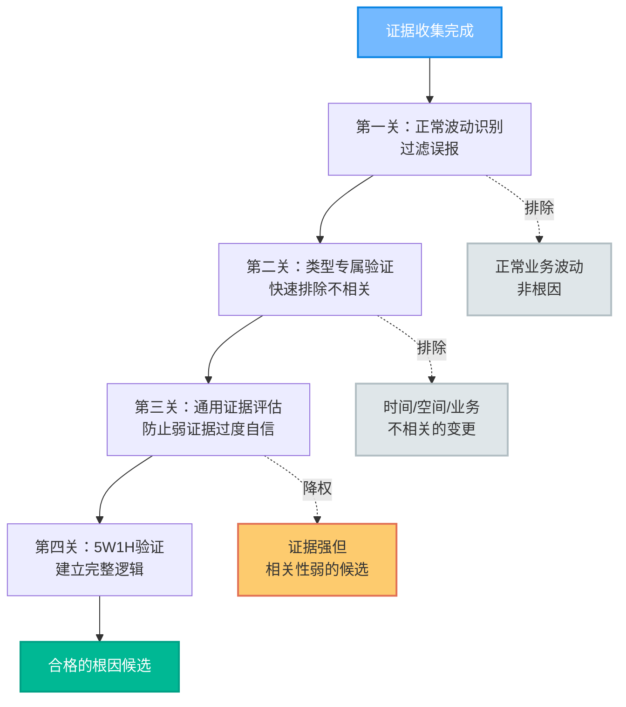
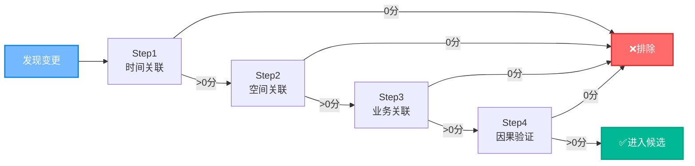
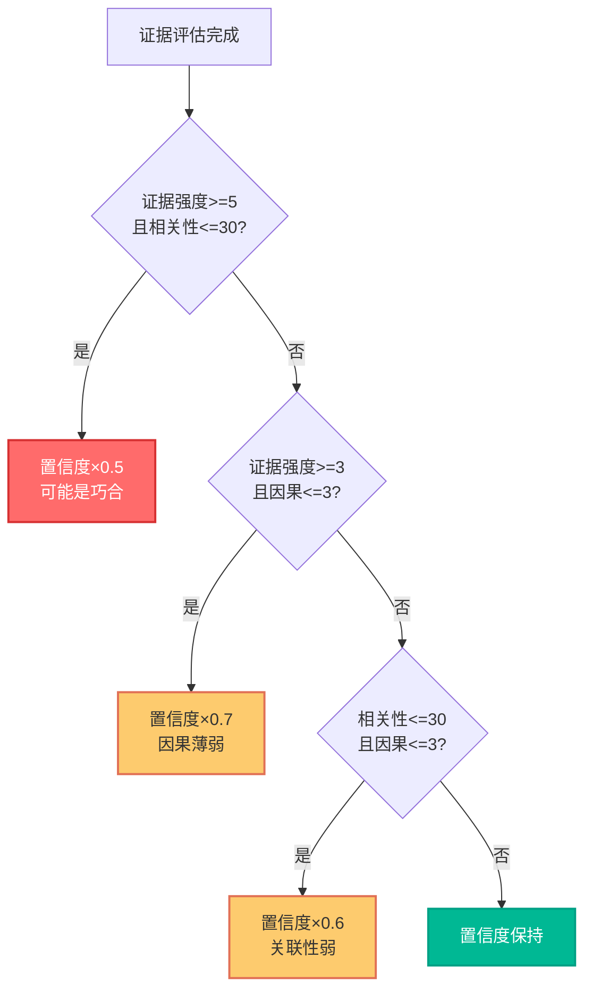
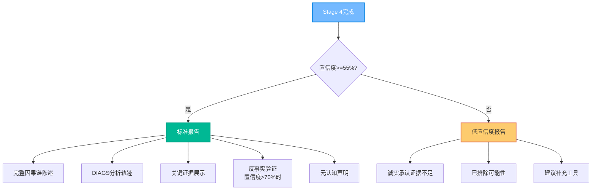
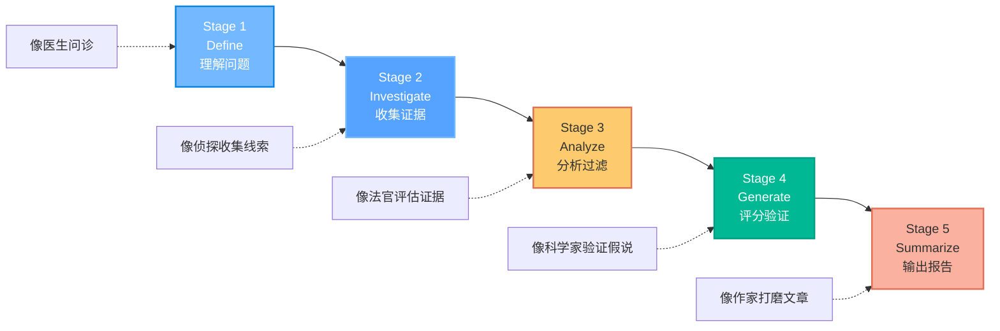
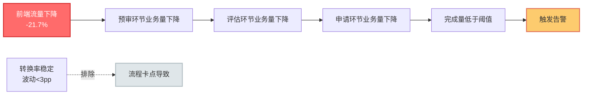

* content
{:toc}



> 一个融合专业方法论与CoT推理的智能告警分析框架, 本文作者是[本末丶](http://blog.leanote.com/benmo) 

## 📖 背景与动机

### 问题现状

在现代复杂的分布式系统中，运维团队每天面临大量告警，如何快速准确地定位根因是提升系统可靠性的关键。传统的告警分析面临以下挑战：

1. **简单规则匹配的局限性**
   - 过度依赖单一证据（如"有变更就是根因"）
   - 缺乏时间因果关系的深度验证
   - 置信度评估不科学，容易出现"100%自信的错误判断"

2. **缺乏系统化方法论**
   - 分析流程不规范，依赖个人经验
   - 没有统一的证据评估标准
   - 推理过程不透明，无法追溯决策依据

3. **AI推理能力不足**
   - 容易将现象当作根因（如"RpcException异常"而非"配置错误导致的异常"）
   - 缺乏自我验证和反思机制
   - 无法识别正常波动与真实异常的差异

### 设计目标

我们的目标是构建一个**智能根因分析框架**，让AI能够：
- 像资深SRE专家一样系统化思考
- 展示清晰的推理链条而非直接给结论
- 科学评估置信度，诚实面对不确定性
- 融合专业运维方法论（RCA、MECE、5W1H等）


## 🎯 DIAGS框架设计

### 核心理念

DIAGS是一个**五阶段智能推理框架**，每个阶段都有明确的职责和输出：



### 执行矩阵（Execution Matrix）

框架通过**执行矩阵**驱动分析流程，每个阶段都有清晰的输入、条件、动作和验证：

| Stage | Input | Condition | Action | Output | Validation |
|-------|-------|-----------|--------|--------|------------|
| **1.Define** | 告警数据 | - | 分类+识别+理解+业务解析 | 告警定义域 | ✓ 分类/类型/等级/线索 |
| **2.Investigate.1** | 告警定义域 | ⚠️ ALWAYS | 并行调用基础工具 | 通用结果 | ✓ 全部执行 |
| **2.Investigate.2** | 告警定义域 | 场景规则存在? | Yes→场景规则<br>No→智能选择 | 场景结果 | ✓ 分支执行 |
| **2.Aggregation** | 通用+场景结果 | 全部完成 | 汇总+识别异常时间 | 全部证据 | ✓ 有真实时间 |
| **3.Analyze** | 全部证据 | - | RCA+权重+时空+5W1H+模式+波动矩阵 | 根因候选 | ✓ 候选>0 |
| **4.Generate** | 根因候选 | - | MECE+评分+反事实+置信度 | 排序列表 | ✓ 有置信度 |
| **5.Summarize** | 排序列表 | 置信度>=55? | Yes→标准报告<br>No→低置信度报告 | 最终报告 | ✓ 质量检查 |

## 🔍 五阶段详解

> 把AI训练成资深SRE专家，关键在于让它像人一样思考：理解问题 → 收集证据 → 分析推理 → 生成结论 → 验证输出

### Stage 1: Define（定义阶段）- 像医生问诊一样理解问题

**设计思路**：就像医生看病要先了解症状、病史、生活习惯一样，分析告警的第一步是**准确理解问题本质**。

**解决什么问题？**
- ❌ 传统做法：拿到告警直接分析，缺乏对问题的系统化理解
- ✅ DIAGS做法：先分类、提取关键线索、理解业务背景，再开始分析

**四个关键步骤**：

#### 1.1 告警智能分类
把告警分成4类，**不同类型用不同的分析策略**：



**为什么要分类？** 就像医院有内科、外科、骨科，不同类型的问题需要不同的诊断工具和方法。

#### 1.2 业务要素提取
从告警描述中**智能提取关键信息**，为后续关联验证做准备：

| 要素类型 | 举例 | 用途 |
|---------|------|------|
| 服务/应用 | "订单服务" | 确定分析范围 |
| 业务流程 | "支付流程" | 理解业务影响 |
| 技术组件 | "Redis缓存" | 定位技术层面 |
| 异常特征 | "响应超时5秒" | 量化问题严重程度 |

**类比**：就像警察接到报案，要记录"什么时间、什么地点、发生了什么"，这些信息在后续破案时至关重要。

#### 1.3 业务时效性识别
识别业务对时间的敏感度，**调整时间窗口判断标准**：

- **高时效场景**（登录/支付/实时查询）→ 合理时间窗口：30分钟-1小时
  - 为什么？这类业务实时性强，问题会立即显现
  
- **低时效场景**（报表/统计/批量处理）→ 合理时间窗口：6-24小时
  - 为什么？这类业务延迟执行，问题可能滞后显现

**避免的错误**：6小时前的配置变更，不应该被归因为"实时支付超时"的根因（时间跨度不合理）

#### 1.4 形成告警定义域
把上述信息汇总，形成**完整的问题画像**，作为后续分析的基础。

**输出示例**：
> "这是一个**应用服务类**告警，涉及**订单服务的支付流程**，**高时效场景**，异常特征为**接口响应超时5秒**，告警等级P1。"

---

### Stage 2: Investigate（调查阶段）- 像侦探一样收集证据

**设计思路**：就像侦探破案要收集物证、人证、现场痕迹一样，分析根因需要**从多个维度并行收集证据**。

**解决什么问题？**
- ❌ 传统做法：只查变更记录，证据单一，容易误判
- ✅ DIAGS做法：并行收集多源证据，交叉验证，提高可靠性

**双分支并行调查**：



#### 2.1 通用三件套（必须执行）
**为什么必须执行？** 就像警察办案的标准流程：询问目击证人（关联告警）、调取监控录像（指标趋势）、查案发前的人员活动（变更记录），这是最基础的证据来源。

| 工具 | 查询内容 | 提供的证据 | 时间窗口 |
|------|---------|-----------|---------|
| 变更管理系统 | 相关服务的变更记录 | 代码部署、配置修改、流程变更 | 告警前24小时 |
| 告警平台 | 同时段其他告警 | 是否有关联服务异常、是否批量故障 | 告警前2小时 |
| 监控系统 | 指标历史趋势 | 何时开始异常、趋势如何变化 | 告警前3小时 |

#### 2.2 场景专用调查（智能选择）
**为什么需要场景专用？** 不同类型的问题需要不同的诊断工具，就像验血和拍X光解决的是不同问题。

**智能选择逻辑**：
```
如果 预定义了场景规则:
    执行场景规则指定的工具（如"数据库慢查询"场景 → 执行慢查询分析工具）
否则:
    根据告警分类自动选择：
    - 基础设施类 → 健康巡检、资源监控、网络检查
    - 应用服务类 → 链路追踪、错误日志、性能分析
    - 数据库类 → 慢查询分析、性能巡检、连接池监控
    - 日志异常类 → 错误日志、堆栈分析、趋势分析
```

#### 2.3 识别真实异常时间
**关键洞察**：⚠️ 告警触发时间 ≠ 异常发生时间

**举例说明**：
- 告警规则：CPU使用率连续5分钟超过80%触发告警
- 告警触发时间：10:30
- **真实异常时间：10:25**（从指标趋势中识别出CPU开始异常的时间）

**为什么重要？** 后续判断"变更时间"与"异常时间"的关联性时，应该用**真实异常时间**而非告警触发时间，否则会错过5分钟的时间窗口。

---

### Stage 3: Analyze（分析阶段）- 像法官审案一样分析证据

**设计思路**：就像法官审案要评估证人证言的可信度、证据的关联性、案件的逻辑链条一样，分析根因需要**系统化评估证据、排除干扰、建立因果关系**。

**解决什么问题？**
- ❌ 传统做法：看到变更就认为是根因，不验证因果关系
- ✅ DIAGS做法：多维度评估，过滤噪音，建立严密的因果逻辑

**三重过滤机制**：



#### 3.1 第一关：正常波动识别矩阵（过滤误报）

**设计目的**：区分"正常的波动"和"真正的异常"，避免把业务的正常峰谷当作根因。

**类比说明**：就像医生要区分"正常的体温波动"和"真正的发烧"一样。

**技术栈指标判断**

| 指标类型 | 举例场景 | ❌ 误报（非根因） | ✅ 真异常（根因） |
|---------|---------|----------------|---------------|
| **存活性**<br>(进程/服务) | 微服务实例健康检查 | 单个Pod重启<br/>（容器编排正常调度） | 批量Pod down<br/>（资源耗尽/镜像问题） |
| **可访问性**<br>(连接/端口) | 数据库连接监控 | 个别连接超时<br/>（网络抖动） | 批量超时/连接池耗尽<br/>（数据库hang住） |
| **资源效率**<br>(CPU/内存) | 服务器资源监控 | 内存80-90%<br/>（高位运行正常） | 内存OOM/CPU突增3倍+<br/>（资源泄漏/流量攻击） |

**业务场景指标判断**

| 指标类型 | 举例场景 | ❌ 误报（非根因） | ✅ 真异常（根因） |
|---------|---------|----------------|---------------|
| **容量状态**<br>(堆积/积压) | 消息队列监控 | 早高峰小幅堆积<br/>（正常峰谷） | 持续堆积不下降<br/>（消费者故障） |
| **效率健康**<br>(耗时/RT) | 接口性能监控 | 个别慢请求<br/>（长尾效应） | P99突增3倍+<br/>（慢查询/死锁） |
| **逻辑正确**<br>(成功率/准确率) | 订单支付成功率 | 在历史正常区间波动<br/>（风控策略调整） | 超出历史区间/骤降<br/>（支付渠道故障） |

**过滤逻辑**：如果候选根因是"内存80%"或"周期性波动"，直接排除，因为这是正常状态。

#### 3.2 第二关：变更关联4步验证法（避免时间巧合）

**设计目的**：严格验证"变更"与"告警"的因果关系，**避免仅凭时间接近就判定为根因**。

**核心理念**：时间相关 ≠ 因果相关。就像"鸡叫之后天亮"，但鸡叫不是天亮的原因。

**4步验证，任一步0分立即排除**：



**Step 1: 时间关联验证**

**目的**：变更生效时间与异常发生时间是否在合理窗口内？

| 时间差 | 评分 | 举例场景 |
|-------|------|---------|
| 0-30分钟 | 100分 | 配置变更后立即生效，30分钟内告警 ✅ |
| 30分钟-1小时 | 80分 | 代码发布后，流量逐步切换，1小时内告警 ✅ |
| 1-2小时 | 50分 | 缓存逐步失效，2小时内告警 ⚠️ |
| 2-6小时 | 30分 | 定时任务触发，需验证是否有关联 ⚠️ |
| 6-12小时 | 10分 | 时间跨度大，关联性存疑 ❌ |
| >12小时 | 0分 | **72小时前的变更与当前告警无关** ❌ |

**智能调整**：
- **高时效业务**（支付/登录）+ 时间差>2小时 → 评分×0.3（几乎不可能）
- **低时效业务**（报表/批处理）+ 时间差6小时 → 可接受

**Step 2: 空间关联验证**

**目的**：变更对象与告警对象是否有关系？

| 关联类型 | 评分 | 举例场景 |
|---------|------|---------|
| **直接匹配** | 100分 | 修改了订单服务代码 → 订单服务告警 ✅ |
| **上下游依赖** | 80分 | 修改了支付网关 → 订单服务（调用支付）告警 ✅ |
| **共享资源** | 60分 | 修改了Redis配置 → 多个服务（共享Redis）告警 ✅ |
| **无关联** | 0分 | 修改了日志服务 → 支付服务告警 ❌ |

**Step 3: 业务关联验证**

**目的**：变更内容与告警业务是否有逻辑关联？

**示例1（高关联）**：
- 告警：订单服务的**支付流程**成功率下降
- 变更：修改了订单服务的**支付接口配置**
- 评分：100分 ✅（业务功能完全匹配）

**示例2（无关联）**：
- 告警：订单服务的**支付流程**成功率下降
- 变更：修改了订单服务的**用户注册模块**
- 评分：0分 ❌（功能不相关）

**Step 4: 因果验证**

**目的**：能否建立清晰的因果传导链？

**评分维度**：信息完整度 × 证据强度 × 因果链长度

| 案例 | 信息完整度 | 证据强度 | 因果链 | 评分 |
|------|-----------|---------|--------|------|
| 修改了支付接口超时参数3s→1s<br/>→ 支付接口超时告警 | 完整<br/>（知道具体改了什么） | 强<br/>（有错误日志） | 单跳<br/>（直接因果） | 100分 ✅ |
| 有配置变更工单<br/>→ 某服务慢 | 缺失<br/>（不知道改了什么） | 弱<br/>（无日志） | 多跳<br/>（推测） | 40分 ⚠️ |
| 修改了日志格式<br/>→ 支付成功率下降 | 完整 | 无 | 无法建立 | 0分 ❌ |

**关键洞察**：必须能够用"因为...所以..."的逻辑串联起来，否则就是时间巧合。

#### 3.3 第三关：通用证据强度评估（防止弱证据过度自信）

**设计目的**：有证据不等于可靠证据，需要从3个维度评估证据质量。

**核心理念**：相关性 > 完整性。信息再完整，如果不相关也没用。

**3维度评估**：

| 维度 | 举例说明 | 评分逻辑 |
|------|---------|---------|
| **1. 证据直接性**<br/>(0-10分) | ✅ 错误日志含明确异常+3分<br/>✅ 日志含堆栈/错误码+3分<br/>✅ 指标在关键点突变+2分<br/>✅ 关联告警现象一致+2分 | 累加计分<br/>直接证据权重高 |
| **2. 时空业务相关性**<br/>(0-100分) | 变更类：时间×0.3 + 空间×0.4 + 业务×0.3<br/>容量类：瓶颈时间×0.5 + 资源范围×0.5<br/>依赖类：异常时间×0.5 + 调用链×0.5 | 根据根因类型<br/>动态计算相关性 |
| **3. 因果合理性**<br/>(0-9分) | 信息完整度（完整3/部分2/缺失1）<br/>×<br/>因果链长度（单跳3/双跳2/多跳1） | 既看信息质量<br/>也看推理距离 |

**降权规则（关键）**：



**案例说明**：
- **案例1**：有详细的错误日志（证据强度8分），但变更发生在72小时前（相关性10分）
  - **判定**：可能是巧合，置信度×0.5 ⚠️
  
- **案例2**：有变更记录但不知道改了什么（信息完整度1分，因果合理性1分）
  - **判定**：因果薄弱，置信度×0.7 ⚠️

#### 3.4 第四关：5W1H深度验证（建立完整逻辑）

**设计目的**：像资深SRE一样，从6个维度全面验证根因的合理性。

**验证框架**：

| 维度 | 验证内容 | 反思问题 |
|------|---------|---------|
| **What**<br/>（是什么） | 异常的本质特征<br/>区分表面现象与深层问题 | 这是根因还是现象？<br/>（❌ CPU高 vs ✅ 慢查询导致CPU高） |
| **When**<br/>（何时） | 时间序列分析<br/>验证时间因果关系 | 时间上能建立因果链吗？<br/>会不会是时间巧合？ |
| **Where**<br/>（何处） | 影响范围和传播路径<br/>验证空间关联性 | 影响范围匹配吗？<br/>传播路径合理吗？ |
| **Who**<br/>（谁） | 责任主体和影响对象<br/>确认关联实体 | 变更对象是告警组件吗？<br/>还是不相关的其他组件？ |
| **Why**<br/>（为什么）| **根本原因的逻辑推理**<br/>最关键的维度 | 能用"因为...所以..."串起来吗？<br/>逻辑链条严密吗？ |
| **How**<br/>（如何） | 故障机制和恢复路径<br/>技术实现验证 | 技术上能解释吗？<br/>符合系统架构吗？ |

**示例分析**：

假设根因候选："Redis配置变更导致订单服务响应慢"

- ✅ **What**：根因是配置变更，现象是响应慢（区分清晰）
- ✅ **When**：变更时间10:00，异常时间10:05（时间合理）
- ✅ **Where**：订单服务依赖Redis（空间关联）
- ✅ **Who**：Redis是订单服务的依赖组件（实体关联）
- ✅ **Why**：因为Redis最大连接数从1000改为100，所以连接池耗尽，所以订单服务响应慢（逻辑清晰）
- ✅ **How**：修改Redis连接数参数立即生效，订单服务获取不到连接（技术合理）

**六维度全部通过 → 这是一个高置信度的根因候选** ✅

---

### Stage 4: Generate（生成阶段）- 像科学家一样评分和验证

**设计思路**：就像科学家提出假说后要严格验证一样，对每个根因候选进行**多维度评分、反事实验证、置信度校准**。

**解决什么问题？**
- ❌ 传统做法：简单打分，置信度不科学（要么100%，要么0%）
- ✅ DIAGS做法：8维度综合评分 + 反事实推理 + 科学的置信度分层

#### 4.1 MECE根因分类（系统化生成候选）

**MECE原则**：Mutually Exclusive Collectively Exhaustive（相互独立，完全穷尽）

基于Stage 3的证据，按7大类生成根因候选：

| 根因类型 | 典型场景 | 判断依据 |
|---------|---------|---------|
| **变更类** | 代码部署/配置修改/流程变更 | 变更记录 + 4步验证通过 |
| **容量类** | 流量突增/资源耗尽/队列积压 | 指标趋势 + 资源监控 |
| **依赖类** | 上游服务异常/中间件故障/外部接口超时 | 关联告警 + 调用链追踪 |
| **环境类** | 网络故障/硬件问题/系统升级 | 基础设施监控 |
| **业务类** | 流量变化/策略调整/用户行为异常 | 业务指标趋势 |
| **配置阈值类** | 监控阈值设置不合理 | 正常波动但触发告警 |
| **数据质量类** | 数据采集异常/计算错误/统计口径变化 | 数据源校验 |

**为什么要MECE分类？** 确保不漏掉任何可能性，也不重复分析同一类问题。

#### 4.2 8维度智能评分（科学的综合评估）

**评分公式**：

```
根因得分 = 问题匹配(20%) + 证据支撑(20%) + 逻辑合理(15%) 
         + 业务关联(15%) + 变更关联(15%) + 时间关联(8%) 
         + 影响范围(4%) + 场景规则(3%)
```

**权重设计理念**：
- **问题匹配**和**证据支撑**各占20%：最重要的两个维度
- **逻辑合理**、**业务关联**、**变更关联**各15%：验证因果关系
- **时间关联**8%：时间只是参考，不是决定性因素
- **影响范围**和**场景规则**：辅助验证

**变更类特殊处理**：直接复用Stage 3的4步验证结果，避免重复计算。

#### 4.3 反事实推理验证（像哲学家一样质疑）

**什么是反事实推理？** 通过假设"如果不是这样"来验证因果关系的必然性。

**四重验证**：

| 验证维度 | 反思问题 | 举例说明 |
|---------|---------|---------|
| **排他性** | 如果不是该根因，<br/>能否找到其他解释？ | 排除Redis变更，还能解释订单服务慢吗？<br/>❌ 不能 → 排他性强 ✅ |
| **充分性** | 该根因能解释<br/>所有观察到的异常吗？ | Redis连接池耗尽，能解释订单慢、支付慢、库存慢吗？<br/>✅ 能 → 充分性强 ✅ |
| **必要性** | 缺少该根因，<br/>异常是否还会发生？ | 不改Redis配置，订单服务还会慢吗？<br/>❌ 不会 → 必要性强 ✅ |
| **证据完备性** | 推理链每个环节<br/>都有证据支撑吗？ | Redis配置变更 → 连接池耗尽 → 订单服务获取连接超时 → 响应慢<br/>每一步都有日志或指标 → 完备 ✅ |

**未通过反事实检验 → 降低置信度或标记"需验证"**

#### 4.4 科学的置信度校准体系

**为什么需要分层？** 让AI学会说"我不确定"，避免过度自信的错误判断。

| 置信度区间 | 门槛要求 | 语言表达 | 处理建议 |
|-----------|---------|---------|---------|
| **最高（95%）** | ≥4维度≥90分<br/>+ 直接证据≥3个<br/>+ 逻辑完全合理 | "确定是..." | 自动处理 |
| **高（85-94%）** | ≥3维度≥80分<br/>+ 直接证据≥2个<br/>+ 无逻辑矛盾 | "很可能是..." | 自动处理 |
| **中等（70-84%）** | ≥2维度≥70分<br/>+ 主要证据充分 | "可能是..." | 人工确认 |
| **低（55-69%）** | ≥1维度≥60分<br/>+ 存在支撑证据 | "怀疑是..." | 补充调查 |
| **无明确根因（<55%）** | 各维度均<60分<br/>或存在严重矛盾 | "证据不足" | 诚实承认 |

**关键设计**：
- 最高置信度只给95%，永远不说100%（保持谦逊）
- 低于55%诚实承认证据不足（避免瞎猜）
- 根据置信度调整语言确定性（区分"确定"、"可能"、"怀疑"）

---

### Stage 5: Summarize（总结阶段）- 像作家一样输出报告

**设计思路**：就像作家写文章要反复推敲、自我审查一样，输出前要进行**根因陈述质量检查、元认知监控、格式规范验证**。

**解决什么问题？**
- ❌ 传统做法：数据堆砌，逻辑混乱，分不清根因和现象
- ✅ DIAGS做法：流畅表达完整因果链，透明声明推理质量

#### 5.1 根因陈述质量检查（5项标准）

**设计目的**：确保输出的根因分析清晰、准确、易懂。

| 检查项 | 标准 | ❌ 错误示例 | ✅ 正确示例 |
|-------|------|-----------|-----------|
| **合并一句话** | 根因分析必须一句话完整表达 | "订单服务慢。<br/>原因是Redis。" | "由于Redis连接池配置从1000改为100，导致连接池耗尽，引发订单服务获取连接超时，最终触发响应慢告警。" |
| **区分根因/现象** | 根因=原因<br/>现象=表现 | "CPU使用率高是根因" | "慢查询导致CPU使用率高" |
| **完整因果链** | 展开证据→根因→传导→现象 | "配置变更导致告警" | "配置变更→连接池耗尽→获取连接超时→服务响应慢→告警" |
| **表达流畅** | 用"由于...导致...引发...最终触发..."串联 | "Redis有变更。服务慢。" | "由于Redis配置变更导致连接池耗尽，引发服务响应慢，最终触发告警。" |
| **避免数据堆砌** | 具体数据放"关键证据"章节 | "10:00变更，10:05告警，内存80%，CPU70%..." | "基于变更记录、指标趋势分析，..." |

**类比说明**：就像写论文要有清晰的论点、论据、论证过程，不能东拼西凑。

#### 5.2 元认知监控（AI的自我反思）

**什么是元认知？** AI对自己推理过程的反思，意识到自己哪里强、哪里弱、哪里不确定。

**5个反思维度**：

| 维度 | 反思问题 | 目的 |
|------|---------|------|
| **推理强度** | 哪些环节的推理比较薄弱？<br/>哪些地方需要更多证据？ | 识别薄弱环节<br/>提示需要补充的调查 |
| **认知偏差** | 是否因为"看到变更"就认定是根因？<br/>（确认偏差）<br/>是否被第一印象锚定？<br/>（锚定效应） | 避免常见认知陷阱<br/>保持客观中立 |
| **替代解释** | 除了主要候选，<br/>是否考虑了其他可能性？ | 确保没有遗漏<br/>提供备选方案 |
| **知识边界** | 哪些技术栈或业务场景<br/>超出了确定性知识范围？ | 诚实面对不确定性<br/>避免过度推测 |
| **假设识别** | 做了哪些隐含假设？<br/>如果假设不成立会怎样？ | 明确推理的前提条件<br/>评估结论的稳健性 |

**元认知声明示例**：
> "推理强度：时间关联和证据支撑较强，但缺乏调用链追踪验证。知识边界：对该业务的风控策略了解有限，可能存在业务策略调整导致的正常波动。"

#### 5.3 智能输出格式

**根据置信度选择不同模板**：



**标准报告结构**（置信度 ≥ 55%）：

1. **📊 分析概览**：告警标题、时间、框架
2. **🎯 根因分析**：一句话完整因果链 + 其他可能性（如有）
3. **📌 DIAGS分析轨迹**：5个阶段的关键发现（证明推理严密）
4. **📌 关键证据**：分业务/技术/专业分析三类展示
5. **📌 反事实验证**：排他性/充分性/必要性/证据完备性（置信度>70%）
6. **📌 元认知声明**：透明声明推理质量和不确定性

**低置信度报告结构**（置信度 < 55%）：

1. **🎯 根因分析**：诚实承认证据不足，不瞎猜
2. **📌 分析轨迹**：简述执行情况、证据状况、为何不足
3. **📌 已排除可能性**：至少说明哪些不是根因（体现工作价值）
4. **📌 建议补充工具**：明确指出需要补充哪些调查

**关键设计**：
- 高置信度：详细展示推理过程，建立信任
- 低置信度：诚实承认，提供调查方向，而非瞎猜（体现专业性）

---

**五阶段总结**：



## 🎨 核心设计创新

### 1. CoT声明式矩阵

**执行矩阵驱动**：通过表格化的条件判断、业务推理、反事实验证，实现：
- **逐步推理**：展示清晰思考链条，而非直接给结论
- **自我验证**：主动质疑自己的推理，寻找反例
- **元认知监控**：意识到推理的薄弱环节和知识边界
- **因果重构**：构建完整因果链，而非孤立判断

### 2. 多源证据融合

**动态权重评估**：
- 直接证据(1.0)：错误日志、异常指标、系统事件
- 间接证据(0.7)：性能趋势、资源异常、上下游状态
- 关联证据(0.5)：同时段告警、网络状况、外部依赖
- 推测证据(0.3)：经验推断、模式匹配、配置变更

### 3. 正常波动识别

**避免误报**：通过技术栈和业务场景双维度矩阵，识别正常波动与真实异常：
- 高位运行≠根因，资源耗尽=根因
- 周期性波动≠根因，失控积压=根因
- 个别超时≠根因，批量超时=根因

### 4. 变更关联4步验证法

**避免时间巧合**：严格验证变更与告警的因果关系：
- Step1：时间关联（考虑业务时效性）
- Step2：空间关联（验证对象匹配）
- Step3：业务关联（验证功能相关）
- Step4：因果验证（验证传导路径）

## 📊 实践效果

通过在生产环境应用DIAGS框架，我们取得了显著成效：

| 指标 | 优化前 | 优化后 | 提升 |
|------|--------|--------|------|
| **根因分析有效性** | 40% | 80.6% | **+101.5%** |
| **精准定位率** | 15% | 42% | **+180%** |
| **误判率** | 35% | 12% | **-65.7%** |

---

### 真实案例展示

下面通过3个生产环境的真实案例，展示DIAGS框架的核心能力：

#### 案例1：变更关联4步验证 - 容器健康状态异常

**告警场景**：K8s集群内容器状态处于非running占比监控告警

**框架分析过程**：

🔍 **根因定位**

根据变更记录分析，由于**监控服务A容器在生产集群的发版变更**导致容器状态异常，引发非running状态占比达到告警阈值（当前值1），最终触发容器健康状态监控告警（置信度 68%）。

**变更关联4步验证（核心亮点）**：

| 验证步骤 | 得分 | 验证结果 |
|---------|------|---------|
| Step1-时间关联 | 100分 | 变更时间（14:54）与告警时间（15:06）间隔仅**12分钟** |
| Step2-空间关联 | 100分 | 变更对象（监控服务A）与告警容器**完全匹配** |
| Step3-业务关联 | 100分 | 发版变更**直接影响**容器运行状态 |
| Step4-因果验证 | 70分 | 版本更新可能导致容器重启或初始化失败 |
| **综合得分** | **92.5分** | **高关联性** ✅ |

📌 **其他可能性评估**（体现MECE分析）

- **资源不足**（置信度 45%）：未发现CPU/内存耗尽证据
- **依赖服务异常**（置信度 30%）：关联服务B同期发版，需验证服务间依赖

📌 **恢复建议**

- 立即措施：回滚监控服务A至稳定版本，检查容器日志确认初始化失败原因
- 长期优化：建立容器发版健康检查机制，对关联服务进行兼容性测试

**价值体现**：通过4步验证建立了严密的因果链条，避免了时间巧合误判，提供了可操作的恢复建议。

---

#### 案例2：正常波动识别 - 业务流量自然下降

**告警场景**：金融业务关键指标监控告警：实时申请量一小时完成量动态阈值异常

**框架分析过程**：

🔍 **根因定位**

根据业务流程指标数据分析，由于**前端获客环节流量显著下降**（业务前置检查笔数环比昨日下降21.7%，环比上月同日下降35.8%）导致业务量整体缩减，引发完成量低于动态阈值，最终触发业务关键指标监控告警（置信度 85%）。

📌 **关键证据链**（体现完整因果分析）



📌 **专业分析证据**

- **业务场景证据**：业务全流程各节点业务量同步下降（预审→评估→申请降幅均在21-22%区间）
- **排除证据**：节点转换率保持稳定（波动<3pp），排除流程卡点导致的可能性
- **时间关联验证**：业务量下降趋势从14:00持续至今，与告警触发时间高度吻合

📌 **反事实验证**（全部通过）

- **排他性**：若非流量下降，业务量应保持稳定 ✅
- **充分性**：流量下降能完整解释各环节业务量缩减 ✅
- **必要性**：缺少流量下降因素，告警不会触发 ✅
- **证据完备性**：所有推理环节均有业务数据支撑 ✅

**价值体现**：通过业务流程全链路分析，识别出流量自然波动而非系统故障，避免了误导运维团队进行无效排查。

---

#### 案例3：正常波动识别矩阵 - 避免误报

**告警场景**：金融产品审批通过率10分钟级异常告警

**框架分析过程**：

🔍 **根因定位**

根据指标趋势分析，金融产品X的审批通过率当前值为29.26%，**处于3sigma正常波动范围内（上界33.2%，下界20.5%）**。STL残差值0.045也在正常区间（上界0.0957，下界-0.0810），表明**业务运行正常，无实质性异常**（置信度 85%）。

📌 **正常波动识别矩阵应用**（核心亮点）

| 检查项 | 指标值 | 正常区间/阈值 | 判定 |
|-------|--------|--------------|------|
| **3sigma上下界** | 29.26% | [20.5%, 33.2%] | ✅ 在正常范围内 |
| **STL残差值** | 0.045 | [-0.081, 0.096] | ✅ 在正常范围内 |
| **拒绝规则分布** | 主要拒绝原因波动<1% | 稳定性阈值±2% | ✅ 分布稳定 |
| **关联告警** | 其他业务环节告警 | 无直接关联 | ✅ 独立事件 |

**判定结论**：**业务策略自然波动，无系统故障** ✅

📌 **关键证据分析**

**业务稳定性证据**：
- 拒绝规则分析：主要拒绝原因"多次申请"（规则D352）占比25.84%，"身份验证"（规则D140）占比20.47%，**波动均在1%以内**
- 拒绝规则稳定表明：审批策略执行正常，非系统异常导致

**变更关联4步验证**：

| 验证步骤 | 得分 | 验证结果 |
|---------|------|---------|
| Step1-时间关联 | 50分 | 业务数据维护与告警时间间隔较长 |
| Step2-空间关联 | 60分 | 数据库操作但非核心表 |
| Step3-业务关联 | 70分 | DML操作类型已知但具体内容不明 |
| Step4-因果验证 | 40分 | **无法建立通过率波动的因果链** |
| **综合得分** | **55分** | **关联性较弱** ⚠️ |

**排除证据**：
- 变更影响有限：存在2项中风险变更（业务数据维护、基础设施演练），但经4步验证关联性较弱
- 关联告警独立：同期存在其他业务环节告警，但与审批流程无直接关联

📌 **DIAGS分析轨迹**

- **D-Define**: 识别为业务类告警，核心问题是审批通过率监控触发
- **I-Investigate**: 指标趋势显示在正常范围，拒绝规则分布稳定，变更影响有限
- **A-Analyze**: 应用正常波动识别矩阵，排除变更主因，识别为业务策略自然波动
- **G-Generate**: 高置信度（85%）确认无实质性异常，变更关联性仅55分
- **S-Summarize**: 综合多维度证据验证，建议优化监控策略

📌 **建议措施**

- **短期**：持续观察产品X审批通过率趋势，确认业务稳定性
- **中期**：优化监控策略的动态阈值算法，减少正常波动误报
- **长期**：建立业务策略变更与监控阈值的联动机制

**价值体现**：通过正常波动识别矩阵和3sigma/STL多维度验证，**准确识别业务自然波动，避免误报导致的无效排查**，同时指出监控策略优化方向，提升告警质量。

---

### 案例总结

| 案例 | 告警类型 | 核心能力体现 | 置信度 | 关键价值 |
|------|---------|------------|--------|---------|
| 案例1 | K8s容器健康状态异常 | **4步验证法**<br/>严格验证变更因果关系 | 68% | 避免时间巧合误判<br/>提供恢复建议 |
| 案例2 | 金融业务指标异常 | **完整因果链**<br/>业务全链路分析 | 85% | 识别业务流量波动<br/>避免无效排查 |
| 案例3 | 审批通过率10分钟级告警 | **正常波动识别**<br/>3sigma+STL多维验证 | 85% | 识别业务自然波动<br/>避免误报和无效排查 |

**三个案例展示的不同场景**：
- **案例1（技术故障）**：容器发版变更导致异常 → 4步验证找到真实根因 → 提供回滚建议
- **案例2（业务波动）**：前端流量自然下降 → 全链路分析排除系统故障 → 避免技术团队误排查
- **案例3（监控误报）**：指标在正常范围内 → 正常波动识别 → 建议优化监控策略

**共同特点**：
- ✅ 展示完整的DIAGS分析轨迹（D→I→A→G→S）
- ✅ 提供多维度证据验证（不依赖单一证据）
- ✅ 科学评估置信度（避免过度自信）
- ✅ 给出可操作建议（而非仅结论）

**技术栈覆盖**：容器编排（K8s）、金融业务流程、时序分析（3sigma/STL）、监控策略优化

## 🚀 如何应用

### 1. 适配你的监控系统

**最小化集成**：
```python
# 定义你的告警数据结构
alert_data = {
    "title": "服务响应超时告警",
    "level": "P2",
    "time": "2024-01-15 10:30:00",
    "service": "order-service",
    "metric": "http_request_duration_seconds",
    "value": 5.2,
    "threshold": 2.0,
    "description": "订单服务响应时间超过阈值"
}

# 接入DIAGS框架
analysis = DIAGS_Framework.analyze(alert_data)
```

### 2. 配置你的工具链

**通用三件套**（必选）：
- 变更管理系统：查询相关服务的变更记录
- 告警平台：查询时间窗口内的关联告警
- 监控系统：查询指标的历史趋势数据

**场景专用工具**（可选）：
- 日志系统：错误日志分析、堆栈追踪
- 链路追踪：调用链分析、性能瓶颈定位
- 数据库监控：慢查询分析、连接池监控

### 3. 自定义场景规则

```python
# 定义特定场景的分析规则
scene_rules = {
    "数据库慢查询": {
        "tools": ["慢查询分析", "数据库性能巡检", "连接池监控"],
        "time_window": "-1h",
        "analysis_focus": ["SQL执行计划", "索引使用", "锁等待"]
    },
    "服务调用超时": {
        "tools": ["链路追踪", "错误日志", "性能分析"],
        "time_window": "-30m",
        "analysis_focus": ["调用链路", "超时位置", "依赖服务状态"]
    }
}
```

### 4. 优化置信度阈值

根据你的业务特点调整阈值：
```python
confidence_thresholds = {
    "high_confidence": 85,      # 高置信度：可自动处理
    "medium_confidence": 70,    # 中等置信度：人工确认
    "low_confidence": 55,       # 低置信度：需要补充调查
    "insufficient_evidence": 55 # 证据不足：诚实承认
}
```

### 5. 分析效果


## 💡 最佳实践

### 1. 避免常见陷阱

❌ **错误做法**：
- 将现象当作根因（如"CPU使用率高"而非"慢查询导致CPU高"）
- 仅凭时间相关性判断（变更时间接近就是根因）
- 过度自信（证据不足仍输出100%置信度）
- 忽略正常波动（将业务峰谷波动当作异常）

✅ **正确做法**：
- 区分根因与现象，追溯深层原因
- 执行4步验证，排除时间巧合
- 科学评估置信度，诚实面对不确定性
- 应用波动识别矩阵，过滤正常波动

### 2. 持续优化

**收集反馈**：
- 记录人工修正的案例
- 统计各类根因的准确率
- 识别框架的薄弱环节

**迭代改进**：
- 调整证据权重配置
- 补充场景专用规则
- 优化时间窗口设置
- 扩展故障模式库

### 3. 团队协作

**知识沉淀**：
- 将专家经验转化为场景规则
- 建立故障案例知识库
- 定期review分析报告质量

**流程闭环**：
- 告警触发 → DIAGS分析 → 人工确认 → 修正优化 → 知识沉淀

## 🔮 未来展望

### 1. 多模态融合
- 结合日志文本、指标时序、链路拓扑的多模态分析
- 引入图神经网络建模服务依赖关系

### 2. 自适应学习
- 基于历史案例自动调整权重配置
- 学习新的故障模式并更新经验库

### 3. 预测性分析
- 从被动分析扩展到主动预测
- 识别潜在风险，提前预警

## 📚 参考资源

**专业方法论**：
- **RCA (Root Cause Analysis)**：根因分析方法论
- **MECE (Mutually Exclusive Collectively Exhaustive)**：结构化分类方法
- **5W1H**：六维度逻辑验证法
- **时空关联分析**：基于时间和空间维度的因果关系分析

**相关技术**：
- **CoT (Chain of Thought)**：思维链推理
- **反事实推理**：通过假设验证因果关系
- **元认知监控**：对推理过程的自我反思

## 🤝 贡献与交流

DIAGS框架是一个开放的设计理念，欢迎贡献和使用：
- 分享你的实践经验和优化建议
- 贡献场景专用规则和故障模式
- 提出改进建议和新特性需求


